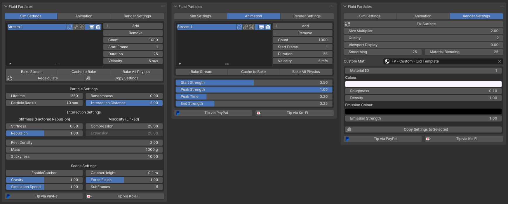
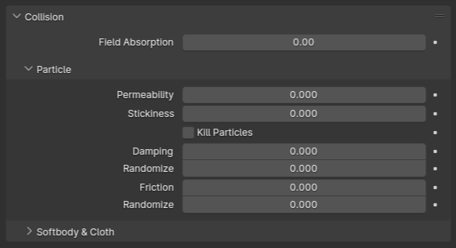
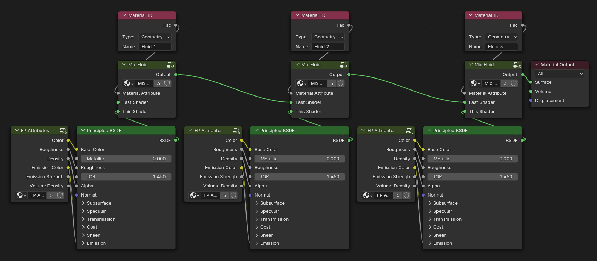

Fluid-Particles
===
A simple tool to create quick fluid sims in blender. 
---

Creating detailed fluid simulations is well known to be a long and arduous process, and even more so in blender, but will give you beautiful results when working on larger scales with lots of fluid. But what if you don't need all that? What if you just need a quick small scale fluid sim? Thankfully, that's what this addon is intended for.

This addon utilizes Blender's particle system's Fluid physics type and is simply designed to be a quick and easy to setup, adjust, and control multiple sims at once in what would otherwise be a confusing and convoluted method of simulating fluid. Designed primarily to be able to add multiple sims that all interact with each other, and automatically set up a fluid surface mesh to render out the fluid and support blending between multiple fluid types.

How To Use
===
The addon is split up into 3 different tabs: Simulation Settings, Animation Settings, and Render Settings.
(Simply listed as "Sim Settings", "Animation", and "Render Settings" since space is limited.)

Simulation Settings
---
All of these sections are pretty self-explanatory, but this tab is where you'll be controlling the fluid parameters. Everything and anything that defines how the fluid will react to the world, as well as itself, is here.

- Streams: Where you'll add/remove particle systems (or "Streams" as I like to call them) from an emitter, as well as control:
  - Particle count: How many particles this stream will emit. This is probably the biggest downside to this method; you have to define exactly how many particles to use as it won't automatically adjust for you.
  - Start Frame: When the selected stream will start emitting particles.
  - Duration: How long the selected stream will emit particles for.
  - Velocity: How strong the particles will emit from the surface (based on the surface normal, so I recommend using a simple plane as an emitter unless you have a specific reason not to).
  - Linking (Chain icons on the list itself): This is how you control what streams will interact with other streams. This is set to off by default (as linking can lead to a huge performance hit depending on how many streams you have), but can be set to only interact with other streams in this emitter (given they also have any kind of linking enabled), or interact with all streams from all emitters (given they are also set to interact with other emitters).
  - Visibility (Screen and camera icons on the list itself): Enable/disable the stream in either the viewport or when rendering. Disabling a stream in the viewport will also keep blender from calculating the stream, which is ideal when you need to work on other parts of your stream and the streams are slowing blender down.
  
  Unlike the other items in this tab, these parameters are all exclusive to each individual stream, so don't be startled if they change when you select a different stream.

- Baking: Not actually simulation parameters, but it's here none the less. Since blender doesn't allow me to only bake all specified simulations at once, I've opted to offer multiple options for whichever suits your needs the most.
 - Bake/Unbake Stream: Only bake or delete the bake of the currently selected stream. (Can sometimes cause issues if trying to bake multiple streams this way, so ideal for when you're only working with a single stream.)
 - Cache to Bake/Unbake Emitter: Will save the playback cache for all streams in each selected emitter or delete all bakes in the selected emitter (if currently selected stream is already baked.)
 - Bake/Unbake All Physics: Will bake all physics of any type in the scene. This includes particle systems, cloth simulations, soft bodies, rigid bodies, etc. (Ideal if you're either only working with fluid sims or want to bake other sim types simultaneously for accurate interactions.)

- Recalculate: Think of this as a panic button, if something goes wrong with the simulation, this'll force all streams on an emitter to reset, clear they're bakes and/or playback caches, rebuild links to other streams, and set the frame to the start of the simulation.
- Copy Settings: This'll copy all settings below from the active emitter to other selected emitters.

- Lifetime: How long the particles will live for. Set to your scene's end frame if you never want them to die. Alternatively, you can add some randomness to when they die to help them fizzle out rather than die at an exact time after being spawned (useful for creating looping animations.)

- Particle Radius: How big the particles are. This'll also affect how close they can get to collision objects.
- Interaction Distance: This defines how close particles must be to interact with eachother, based on their Radius. This does not effect how they react to collision objects.

- Stiffness: How incompressible the fluid is.
- Repulsion: How much particles push away from each other. Linked to Stiffness by default, but clicking on the title "Stiffness (Factored Repulsion)" will unlink them or vice versa.

- Viscosity: How **thicc** the fluid is during either compression or expansion. By default both are controlled together, but clicking on the title "Viscosity (Linked)" will unlink them or vice versa.
  - Compression: How much the fluid resist shearing.
  - Expansion: How much the fluid resist being pulled appart.

- Rest Density: How much particles are allowed to intersect with each other. (Useful when used in tandem with Radius.)

- Mass: How heavy the particles are. Primairly useful when you have 2 different fluids of different masses. i.e., a heavier fluid will displace a lighter fluid.

- Stickyness: How much the particles stick together/attract eachother after previously colliding.

- Particle Catcher: This'll add an invisible plane that'll kill any particles that collide with it, meant to delete particles that go off screen from hurting performance as they endlessly fall into oblivion. (Note that it won't delete particles that are below it, only ones that try to pass said height, so particles that spawn below it won't be deleted. This also won't be copied over to other emitters since it's secretly a global scene setting.)

- Gravity: How much particles are affected by gravity.
- Force Fields: How much particles are affected by other forces (excluding collision objects).

- Simulation Speed: How fast the particles are. Higher speeds will require more subframes as the particles will move more each frame than at lower speeds.
- SubFrames: How frequently blender should calculate the simulation between each frame. Since fluid sims are much more complicated than normal particle simulations, it's important to give blender some leeway to calculate things.

Animation Settings
---
If you've noticed that the particles don't emit at a consistent speed, don't worry, that's a feature not a bug. This is the tab where you'll control changes in the particle's velocity over time, as having them emit at a constant stream is often fairly lackluster and we end up animating it anyway. Unlike the last tab, all these settings are relative to the selected stream.

- Streams and Baking: Exactly the same as in the last tab. I only added this here to be able to easily switch between streams and adjust the velocity for each stream, and cause Baking felt relative and important to add here as well.

- Strength Parameters: How fast the particles will emit at the Start, Peak, and End of the particle's emission, relative to the stream's velocity.
- Peak Time: How far into the particle's emission will they reach their fastest speed.

Render Settings
---
This tab is where you'll control the fluid surface as well as material parameters for emitter's fluid. Keep in mind that these settings are universal and aren't based on the streams at all, outside of the box of material parameters at the bottom that are unique to each emitter. Because of this, you can access these settings from any emitter or even the fluid surface itself (as this is the only tab the fluid surface has).

- Fix Surface: Reimport the fluid surface, its default material, the default custom material template, as well as any hidden objects or parameters that might've gotten broken when deleting an emitter.

- Size Multiplier: How many times larger than the particle's radius should they render as. (Useful for offsetting the smoothing effect the fluid surface provides.)
- Quality: The density of vertices the fluid surface will have (relative to the smallest radius of all emitters).
- Viewport Display (**Does Not Effect The Render!**): Defines the quality of the fluid in the viewport (relative to the quality setting above). Setting this to 0 will hide the fluid surface altogether in the viewport and keep from calculating it at all (as it can be quite slow at times), but will continue to show the particles for each fluid as a lightweight visualization. I recommend leaving this off or at around 0.5 anytime you are adjusting Simulation parameters or working on something else, and around 0.5 anytime you don't actively need to see the fluid surface in great detail.

- Smoothing: How much the surface will be smoothed over, to make it look more fluid like at the cost of minor artifacts when particles are barely touching in weird ways.

- Material Blending: Blends the material parameters for each emitter together wherever the streams interact.

- Custom Material: Where you can create your own material to use instead of the default one. Since blender has no way of nativly blending between materials, you can only set one. I've included a template material (simply named "FP - Custom Fluid Template") so you can easily create a compound material that'll manage different materials. More info on how to do that is below. (Note that the active fluid material is also set on each emitter object for ease of access, so feel free to alter it however you like.)

Material Parameters (relative to each emitter):
- Material ID (Only available with a Custom Material set): This'll let you switch between sections of a compound material. More info below.

- Colour: The colour of this emitter's fluid.
- Roughness: How shiny/matte the fluid is.
- Density: How thick or cloudy the fluid is. (Node that the cycles default material uses volumetrics for density, which can't be controlled dynamically via geometry nodes, so it'll default to the highest density of all emitters.)
- Emission Colour: The colour the fluid will glow. (Set to black to disable.)
- Emission Strength: How strong the fluid will glow.

- Copy Settings: Will copy the active emitter's material parameters to all other selected emitters.

Collision Objects
---
This addon utilizes blender's normal collision settings. Enable it as you would enable collision for object you want to collide with things like cloth. (Also, keep in mind that collision objects will also interact with cloth and soft body simulations. Sorry, I wish it didn't but that's out of my hands.)

(The Particle section is the only one that matters here).

- Permeability: How likely each particle is to pass through the collision object (calculated every frame).
- Damping: How much the collision object will prevent particles from bouncing off it. (Recommend Value: 0.75)
- Friction: How much the collision object will prevent particles from sliding across it. (Recommend Value: 0.25)
- Stickiness: How much particles will stick to the collision object (i.e. overhangs. Recommend Value: 0-0.5).

Setting Up a Compound Material
===
As blender doesn't let you directly blend between multiple materials, there isn't a way for me to easily let you assign materials to different emitters. However, I did add attributes to help you create your own Compound Materials (a material with multiple different materials inside of it). The addon comes included with a template material that is automatically loaded in with your fluid surface. (Do keep in mind that if you only need a single material for all your fluids, then this process isn't at all necessary.)

1) In the fluid particles panel, under Render Settings, set the Custom Material to the included "FP - Custom Fluid Template" material. We do this early just to make sure that the addon won't set it back to the default material when you adjust anything in the addon.

1.5) Alturnatively, if you want to make your own material from scratch, then under any emitter or the fluid surface itself, go to the material properties tab and unlink the "Default Fluid Mat" material (the little X icon next to the name) then add a new material in its place.

2) With an emitter selected (not the fluid surface), under the addon's render settings tab, a new parameter called "Material ID" should've appeared. You can change that to use whichever material inside your compound material that you want.

3) Now we'll open the shader editor and finally start making the compound material. The setup is fairly straightforward, consisting of 4 main parts:
  - Our Fluid Material: This can be whatever you want to use for your fluid, a Principled BSDF shader, a Glass shader, or even just an RGB value. The only things it can't be are volume nodes, as blender doesn't yet allow you to control volumes through geometry node's assigned attributes (outside of instancer attributes, which the Material ID's are not). If your material is really big/has a lot of nodes, it might help to put it inside a group to keep things a bit cleaner.
  - The Included "FP Attributes" Node: This is purely optional, but this is how you can use the material attributes assigned in the addon's "Render Settings" tab.
  - The Included "Mix Fluid" node: This is were we'll connect our material's output (in this case the Principled BSDF's output) into the bottom input labled "This Shader." And most importantly,
  - An Attribute Node: This is where we'll get the mask for each Material ID, using the attributes "Fluid #" for each material. We'll set the first one to "Fluid 1", where the 1 is for emitters with a Material ID of 1, and the next to "Fluid 2" for a Material ID of 2.

4) We can add these in series to have as many different fluid materials as we want, connecting our Mix Fluid node's output to the "Last Shader" input of the next Mix Fluid Node. Copy this over for as many materials you want to use, changing the Attribute node to the proper material ID each time. At the end if it all, your material should look something like this:   

And with that, you're all set. Blender will now automatically blend between these materials when streams collide.
